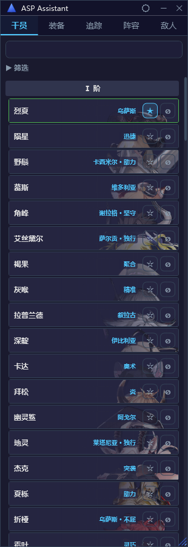
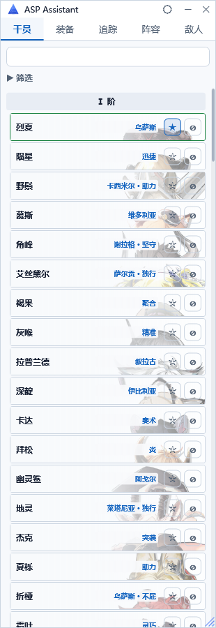
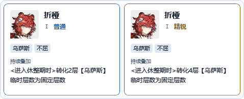
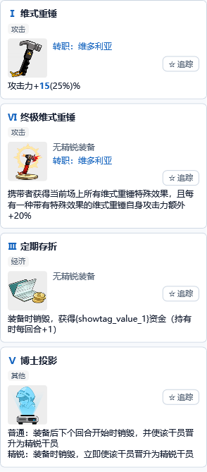
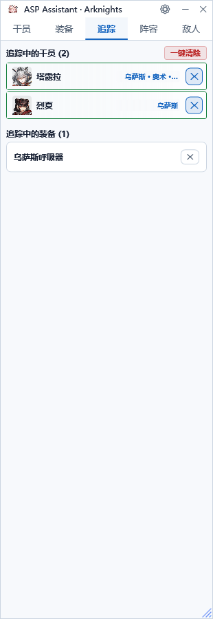

<div align="center">
  
  <h1>ASP Assistant · 规程适配版</h1>
  <p>明日方舟·卫戍协议 辅助工具<br/>基于 Moonfair/ASP_Assistant 修改，由 MaaFramework 提供图像识别能力。</p>
  <p>
    
    
    
    <a href="LICENSE"></a>
  </p>
  <p><a href="https://github.com/Moonfair/ASP_Assistant">原项目</a> · <a href="MODIFICATIONS.md">修改说明</a> · <a href="https://github.com/bingyunhe/ASP_Assistant-Regulation/issues">问题反馈</a></p>
</div>

---

> **项目来源**：本项目是在 [Moonfair/ASP_Assistant](https://github.com/Moonfair/ASP_Assistant) 基础上修改的独立衍生版本，保留原项目 Apache License 2.0 协议与归属声明。感谢 Moonfair 及上游贡献者。本仓库不是原作者发布的版本。
>
> 上游基线：[`93b2ba8`](https://github.com/Moonfair/ASP_Assistant/commit/93b2ba8514f6591a67e4cbf5a6169dee7d065bf6)。本次修改日期为 **2026-11-09**；涉及文件详见 [MODIFICATIONS.md](MODIFICATIONS.md)。

## 截图

以下为测试数据生成的界面截图，不含个人游戏记录。

<div align="center">
  
  
</div>

| 干员悬停详情 | 装备数值对比 | 多队伍追踪 |
| :---: | :---: | :---: |
|  |  |  |

## 功能简介

ASP Assistant 是运行于《明日方舟》游戏窗口旁的侧边辅助工具，提供干员、装备查询，追踪列表、阵容管理与 Ban 位录入。

### 干员浏览与筛选

- 按等阶、核心盟约、其他盟约、词条类型、触发时机与本局状态筛选，支持名称搜索。
- 干员以紧凑列表展示头像、名称与盟约；鼠标悬停即可同时查看普通和精锐信息。
- 可手动追踪或标记禁用；展开的筛选区在滚动时保持展开。
- 原有 Ban 界面分析返回本局可用盟约后，高亮对应选项；“清除高亮”独立于筛选和禁用标记。

### 装备浏览与数值对比

- 按等阶、普通 / 转职 / 专属类型筛选，支持名称搜索与追踪。
- 名称显示在图片上方，取消普通 / 精锐切换按钮。
- 有数值差异时直接合并，例如 `攻击力+15(25%)%`，高亮普通数值 `15`，括号内为精锐数值。
- 没有精锐版本时显示“无精锐装备”；转职装备显示对应盟约。
- 非数值差异保留两种完整说明，例如“博士投影”的不同生效时机。
- 修复选择等阶后无法重新选择“全部”的问题。

### 追踪与阵容

- 将干员、装备加入追踪列表，或从保存的阵容中导入。
- 勾选“同时追踪多个队伍”后，连续追踪阵容会合并目标并去重；未勾选时，下次追踪阵容会替换列表。
- 追踪干员同样显示缩略头像、盟约与普通 / 精锐悬停详情。
- 多队伍共用一份追踪列表，移除目标会从共用列表中移除。

### 截屏录入 Ban 位

- 保留原项目的截屏录入、OCR 候选范围识别及 MaaFramework 头像匹配流程。
- 支持多次截屏任务排队及禁用结果显示。
- 新赛季识别规则的适配范围见下方“当前数据与限制”。

### 外观与窗口

- 标题栏提供黑白主题切换，记住主题选择。
- 支持窗口置顶、拖动和缩放；调整五个页面的内容宽度与筛选布局。
- 开发构建不检查更新；带版本号的发布构建仅检查本仓库 GitHub Releases。

## 当前数据与限制

| 项目 | 状态 |
| --- | --- |
| 数据赛季 | 卫戍协议·规程·序列 I，`act3autochess` / `V3_1` |
| 干员 / 装备 / 盟约 | 141 / 70 / 25 |
| 核心转职盟约 | 从游戏表 `giveBondId` 生成映射；其他转职盟约沿用名称匹配 |
| Ban 位识别 | 沿用原有区域和数量规则，尚未完整适配“规程”；盟约高亮依赖其识别结果 |
| 场上与备战区干员识别 | 尚未实现完整识别流程，不作为本版本已完成功能 |
| 首领 / 敌人数据 | 保留原有数据，尚未同步到本赛季 |
| 自动更新 | 只读取本仓库发布，未发布 Release 时无可用更新 |

## 运行要求

| 条件 | 说明 |
| --- | --- |
| 操作系统 | Windows 10 / 11，x64 |
| .NET 运行时 | 源码构建的非独立版本需要 [.NET 8 Desktop Runtime](https://dotnet.microsoft.com/download/dotnet/8.0) |
| 原生依赖 | 图像识别需要 Microsoft Visual C++ 2015–2022 x64 Runtime；发布流程会打包所需运行库 DLL |
| 游戏客户端 | 明日方舟 PC 版 |
| 游戏画面 | 原有识别布局以 16:9 为基础，实际识别仍受赛季界面和分辨率影响 |

## 获取与构建

无需编译的 Windows x64 独立运行包可在 [Releases](https://github.com/bingyunhe/ASP_Assistant-Regulation/releases/latest) 获取。

1. 下载 `ASPAssistant-v1.0.0-win-x64.zip`，不要选择 `Source code` 源码压缩包。
2. 右键“全部解压”到独立目录，保留全部文件和 `data`、`runtimes` 文件夹。
3. 双击 `ASPAssistant.App.exe` 启动。无需另外安装 .NET；包内带有识别模型和所需运行库。
4. 更新时先退出旧程序，再解压新版。个人追踪与阵容设置存放于本机用户数据目录。

发布页同时提供 `SHA256SUMS.txt`，可用 `Get-FileHash .\ASPAssistant-v1.0.0-win-x64.zip -Algorithm SHA256` 核对下载完整性。详细说明见 [首版发行说明](RELEASE_NOTES.md)。

如果需要从源码构建：

安装 .NET 8 SDK 后，在 PowerShell 中运行：

```powershell
git clone https://github.com/bingyunhe/ASP_Assistant-Regulation.git
cd ASP_Assistant-Regulation
dotnet restore ASPAssistant.sln
dotnet test src/ASPAssistant.Tests/ASPAssistant.Tests.csproj -c Release
dotnet run --project src/ASPAssistant.App
```

仓库已包含当前 JSON 数据、图标和 OCR 模型，首次运行不需要重新抓取数据。

```powershell
# 生成需要 .NET Desktop Runtime 的本地版本
dotnet publish src/ASPAssistant.App/ASPAssistant.App.csproj -c Release --self-contained false -o publish/local

# 生成 Windows x64 独立版本
dotnet publish src/ASPAssistant.App/ASPAssistant.App.csproj -c Release -r win-x64 --self-contained true -o publish/win-x64
```

维护者更新发行说明后，推送 `v` 开头的版本标签即可触发 `.github/workflows/release.yml`。该流程先运行测试，再构建独立运行包、打包运行库与许可证，生成校验文件并发布到 GitHub Releases。

## 更新游戏数据

脚本使用 Python 3.10+；处理图片需要 Pillow。

```powershell
python -m pip install Pillow
cd data
# 只更新本赛季干员、装备、盟约，保留首领和敌人数据
python fetch_spdatabase.py --skip-bosses --skip-enemies
```

已有图标会保留，只下载缺失图标。大量下载可能耗时，建议在游戏空闲时运行。

| 命令 | 功能 |
| --- | --- |
| `python fetch_spdatabase.py --skip-bosses --skip-enemies` | 更新当前干员、装备和盟约数据 |
| `python fetch_spdatabase.py --download-skins` | 下载皮肤头像并重建映射 |
| `python fetch_spdatabase.py --apply-mask` | 为已有皮肤头像补白色背景 |
| `python fetch_spdatabase.py --skip-icons` | 跳过图标下载 |

数据脚本的输出格式和来源沿用原项目，并增加当前赛季读取逻辑；更新数据不会自动完成识别区域适配。

## 数据与项目结构

```text
├── data/
│   ├── operators.json           # 干员、盟约与词条
│   ├── equipment.json           # 装备与普通 / 精锐效果
│   ├── covenants.json           # 盟约与核心转职装备映射
│   ├── skin_avatar_map.json     # 皮肤头像到干员名的映射
│   ├── icons/                  # 干员、装备、敌人等图标
│   ├── model/                  # OCR 模型
│   └── fetch_spdatabase.py      # 数据与图片获取脚本
├── src/
│   ├── ASPAssistant.App/        # WPF 界面
│   ├── ASPAssistant.Core/       # 业务逻辑与数据层
│   └── ASPAssistant.Tests/      # 数据、视图模型和 WPF 回归测试
├── docs/images/                # 无个人信息的界面截图
├── LICENSE                     # Apache 官方标准 License 2.0 正文
├── LICENSE.upstream            # 保留上游许可原文及版权声明
├── NOTICE                      # 上游与第三方归属
└── MODIFICATIONS.md            # 本衍生版本的变更说明
```

个人追踪、阵容、窗口及主题设置存放在本机用户数据目录，不随源码分发。不要把个人配置、游戏截图、日志、密钥或构建缓存提交到仓库。

## 开发依赖与致谢

- [Moonfair/ASP_Assistant](https://github.com/Moonfair/ASP_Assistant)：本项目的上游代码与设计基础。
- [MaaFramework](https://github.com/MaaXYZ/MaaFramework)：OCR、模板与特征匹配。
- [CommunityToolkit.Mvvm](https://github.com/CommunityToolkit/dotnet)：MVVM 基础设施。
- [PRTS Wiki](https://prts.wiki/) 与 [SPDatabase](https://github.com/Yanstory/SPDatabase)：游戏数据和图片来源，具体接口保留在数据脚本中。
- xUnit、Moq、FluentAssertions 等测试依赖遵循各自许可证。

## 许可证

本项目的修改部分以 **[Apache License 2.0](LICENSE)** 开源。`LICENSE` 采用 [Apache 官方标准正文](https://www.apache.org/licenses/LICENSE-2.0.txt)；上游仓库原许可文本的部分措辞与标准正文不同，已逐字保留于 [LICENSE.upstream](LICENSE.upstream)，其中的原始版权声明及上游许可条件继续保留。

分发源码或构建产物时，请一并保留 `LICENSE`、`LICENSE.upstream`、`NOTICE`、`MODIFICATIONS.md` 以及相关文件中的版权和变更声明。

软件许可证不改变《明日方舟》游戏数据、名称、图像和其他第三方资源的权利归属；各依赖遵循其各自的许可证。本项目仅供学习和个人使用，与 Hypergryph / 鹰角网络无关。
